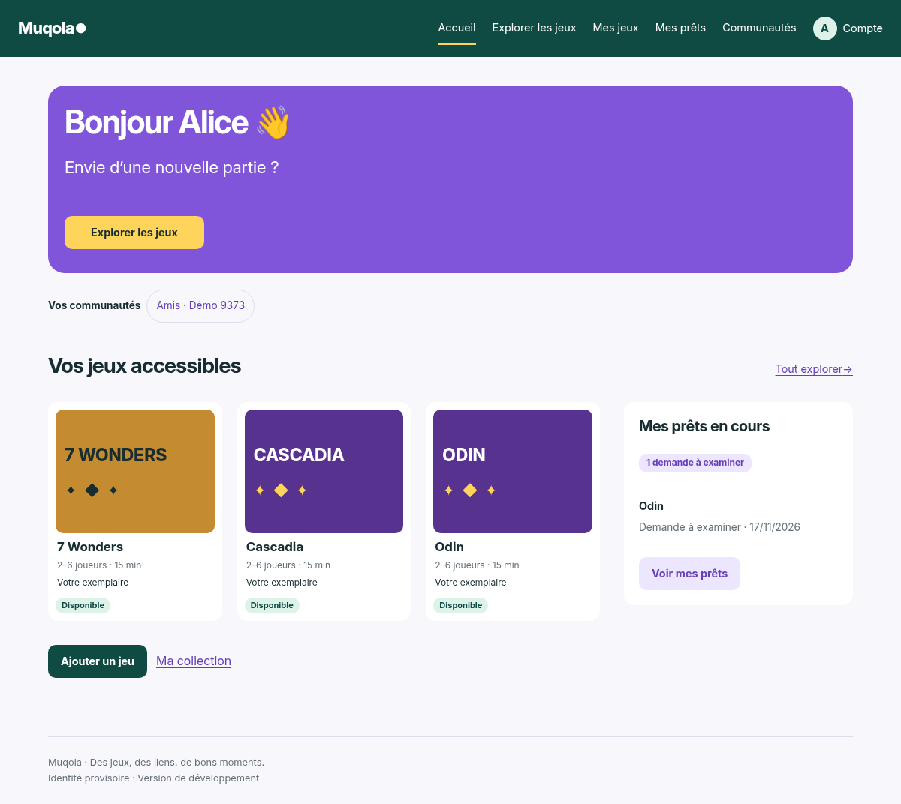
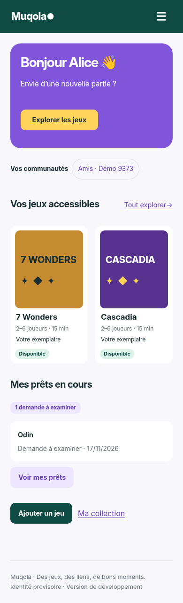
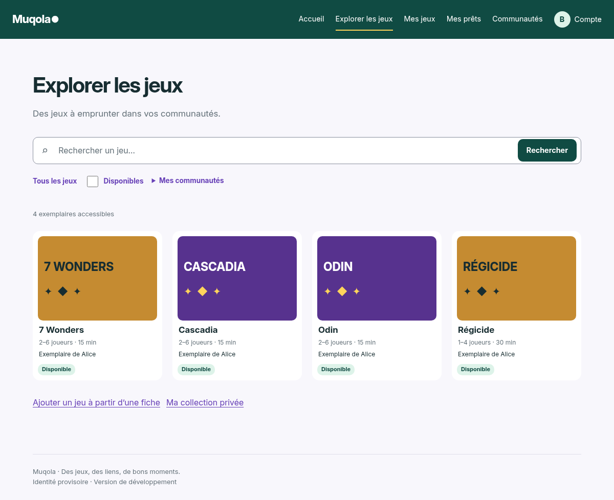
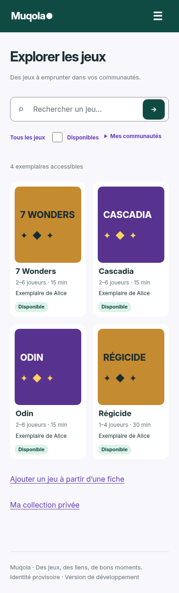
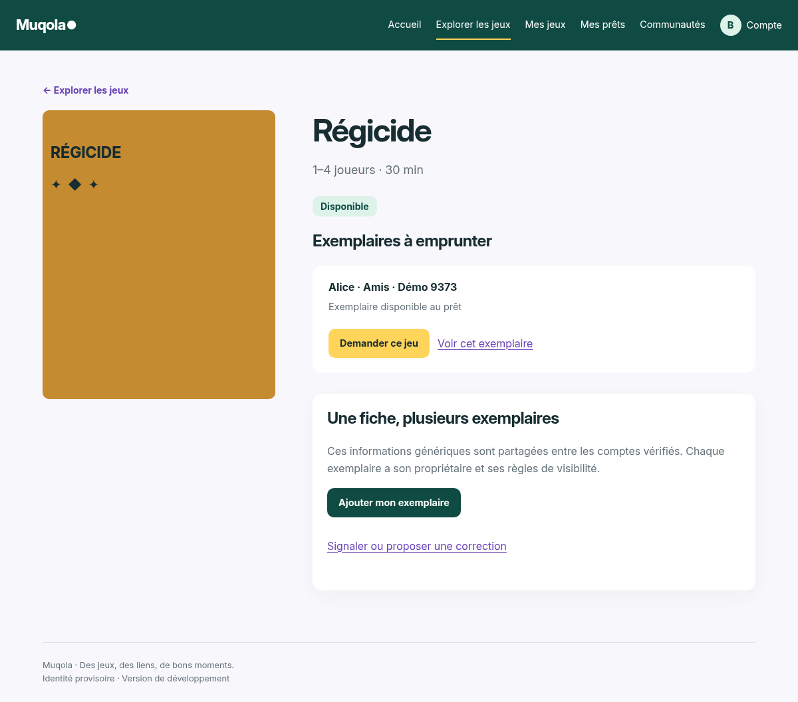
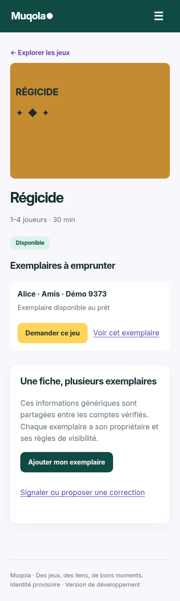

# Refonte UX/UI — audit et correspondance Figma

Branche `feat/ui-redesign`, créée depuis `main` (`6160534`). Référence :
[Muqola dans Figma](https://www.figma.com/design/q4R5MB12qOb0guJW4cb7qW).
Les six contextes détaillés et leurs captures ont été consultés avant l'implémentation.

| Écran | Frames desktop / mobile | Écran Django et données |
| --- | --- | --- |
| Accueil connecté | `1:2` / `1:100` | `identity:dashboard`, appartenances actives du compte, `inventory.visible`, `loans.participant_loans` |
| Explorer | `1:41` / `1:129` | `inventory:index`, SearchForm existant, exemplaires autorisés et pagination existante |
| Fiche de jeu | `1:82` / `1:154` | `catalogue:detail`, métadonnées génériques et seuls exemplaires visibles ; `inventory:request` pour chaque demande |

L'audit couvre README/TASKS, URLs, vues, formulaires, templates, CSS/JS et tests
existants. Les cartes Explorer représentent des exemplaires physiques ; elles
mènent à la fiche générique avec sa liste d'exemplaires, où un lien permet de consulter
l'exemplaire précis. La fiche reste réutilisable sans divulguer de collection privée.
Les noms de communautés affichés pour une copie sont limités aux appartenances
actives du lecteur. Aucun compteur, propriétaire ou communauté privée supplémentaire.

## Mise en œuvre

1. Tokens CSS, composants communs, navigation adaptée à l'état de vérification.
2. Accueil : vraies communautés, exemplaires accessibles et prêts à suivre.
3. Recherche, filtres existants, grille et états vides.
4. Fiche générique et actions sur chaque exemplaire ; aucun changement des transitions.
5. Harmonisation des autres parcours et formulaires.
6. Tests serveur, navigateur, responsive et comparaison visuelle.

Les boîtes Figma sont des rectangles et des textes, sans asset image/SVG ni
Code Connect dans les contextes reçus. Elles deviennent des visuels neutres CSS,
avec le titre réel et une couleur stable par fiche, sans images distantes ni upload.
Inter Variable 4.1 est distribuée localement, inchangée, avec sa licence OFL :
https://github.com/rsms/inter/tree/v4.1. Aucune police ni ressource externe au runtime.
La CSP autorise uniquement les polices locales (`font-src 'self'`).

La palette principale reprend #104B43, #8055D9, #FFD45B, #F8F7FC, #172D31,
#637078. Les petits liens violets utilisent une teinte plus sombre pour le contraste.
Les dimensions sont fluides : les valeurs absolues des prototypes ne sont pas copiées.
Le menu est une amélioration JavaScript : sans JS, tous les liens restent visibles.

## Adaptations au produit réel

- Compte/déconnexion, état actif de navigation, communautés réelles et demandes
  à examiner ajoutés aux maquettes, conformément au périmètre demandé.
- Accueil : aperçu de trois cartes sur ordinateur/tablette et deux sur mobile,
  comme Figma. Explorer conserve tous les résultats autorisés et leur pagination.
- Métadonnées absentes indiquées comme telles ; propriétaires et état privé des
  copies identifiés ; pas de nombres de joueurs/durées ni de prêts inventés.
- Formulaires et filtres natifs réellement soumis au serveur, avec compteur
  autorisé de résultats ; aucun onglet factice.
- Les contenus longs augmentent la hauteur des cartes et formulaires.
- Aucune modification des modèles, migrations, services métier ou de Gunicorn.

## Validation exécutée

- `./scripts/check.sh` : Ruff lint/format, mypy, Django, migrations/statiques,
  **133 tests PostgreSQL réussis**, dont 10 tests ciblant les présentations, la
  navigation selon vérification, les communautés filtrées et les actions des copies.
- `scripts/browser_smoke.py` : accueil public, CSS, français, clavier, 360/1280.
- `scripts/accounts_browser_smoke.py` : inscription, SMTP capturé, vérification
  dans un autre contexte, compte non vérifié bloqué, connexion/reset/logout, 360/1280.
- `scripts/product_browser_smoke.py` : invitation, fiche réutilisée, copie privée,
  accès croisés, prêt complet malgré retrait, contacts temporaires et notifications.
- `scripts/ui_browser_smoke.py` : trois écrans à 360/390/768/1200/1280, 15 captures,
  clavier et vrais événements tactiles émulés, Escape, retour du focus, resize,
  compte, filtres natifs/recherche sans accents, état vide, demande datée, sans JS,
  et contenus longs aux cinq largeurs ; aucune erreur JS ou ressource réseau.
- Contrôle Django `check --deploy --fail-level WARNING` : succès, deux exceptions
  HSTS préexistantes inchangées. `pip-audit` : aucune vulnérabilité runtime connue.
- Contrastes calculés : texte principal/fond 13,53:1, secondaire/blanc 5,10:1,
  petits liens/fond 6,58:1, bouton jaune 10,18:1, blanc/hero 4,98:1.

Les essais locaux emploient de vraies instances Django/Gunicorn, PostgreSQL et
Mailpit, sur des bases de développement fictives isolées. Aucun envoi SMTP externe.
Les sélecteurs comptes ont été adaptés au nouveau libellé Bonjour et à l’ouverture
réelle du menu/compte pour se déconnecter, sans retirer de vérification fonctionnelle.

La CI répète tous ces parcours, construit Docker, contrôle les préconnexions
Gunicorn et le profil HTTPS Codespaces. Les 15 captures et le rapport JSON sont
conservés sept jours comme artefact `muqola-responsive-screenshots`.

## Comparaison visuelle

Comparaison manuelle des captures ci-dessous avec les six références Figma :
structure, palette, Inter, rayons, couvertures neutres, deux colonnes mobile et
fiche 350 px / contenu sur desktop. Les adaptations listées plus haut sont
intentionnelles : données réelles et tri existant, couleur neutre stable par ID
(elle ne prétend pas reproduire une couverture réelle), communautés/compteurs,
liens de gestion et footer. Sur les aplats ocre, le titre est sombre pour le contraste.
Les pages peuvent être plus longues que les frames fixes ; aucun contenu nécessaire
n'est tronqué pour tenir dans leur hauteur. Aucun screenshot Figma n'est un asset runtime.

| Écran | Desktop 1200 px | Mobile 390 px |
| --- | --- | --- |
| Accueil |  |  |
| Explorer |  |  |
| Fiche |  |  |

## Limites et validation humaine

Tests Chromium automatisés et vérification visuelle, pas un audit d’accessibilité
exhaustif ni une validation sur appareil Android physique, Safari ou lecteur d’écran.
Le build Compose complet local n'a pas été relancé (stockage `vfs` limité) ; il est
vérifié en CI. La barrière d’authentification d’un vrai Codespace reste à valider
par l’utilisateur avec le guide existant ; son profil backend HTTPS est testé en CI.
Aucune mise en production ni tâche du lot 6.

Sur ordinateur, récupérer la branche puis :

```sh
python3 scripts/init_dev.py
docker compose up --build --wait --wait-timeout 120
```

Ouvrir http://localhost:8000 et http://localhost:8025, utiliser deux profils de
navigateur et uniquement des comptes fictifs. Vérifier l’accueil sans communauté,
le menu (Tab/Entrée/Escape et souris/tactile), les filtres, une fiche avec plusieurs
exemplaires, l’ajout privé et le prêt complet du [guide manuel](manual-validation.md).
Reproduire à 360/390/768/1200/1280 et désactiver JS pour vérifier le fonctionnement natif.

